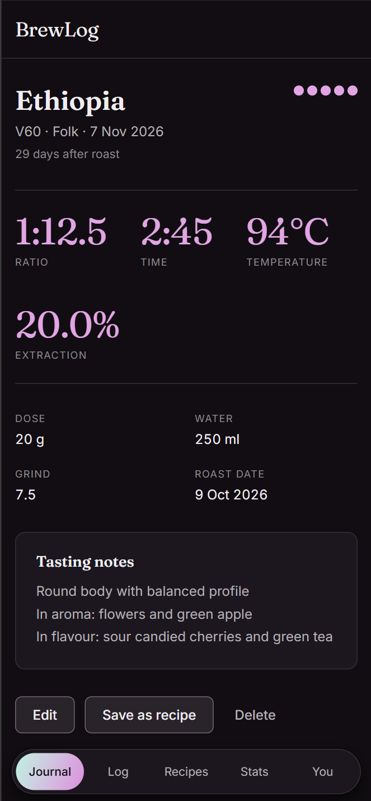
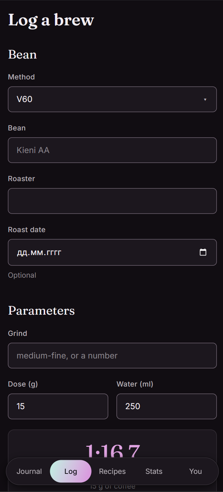
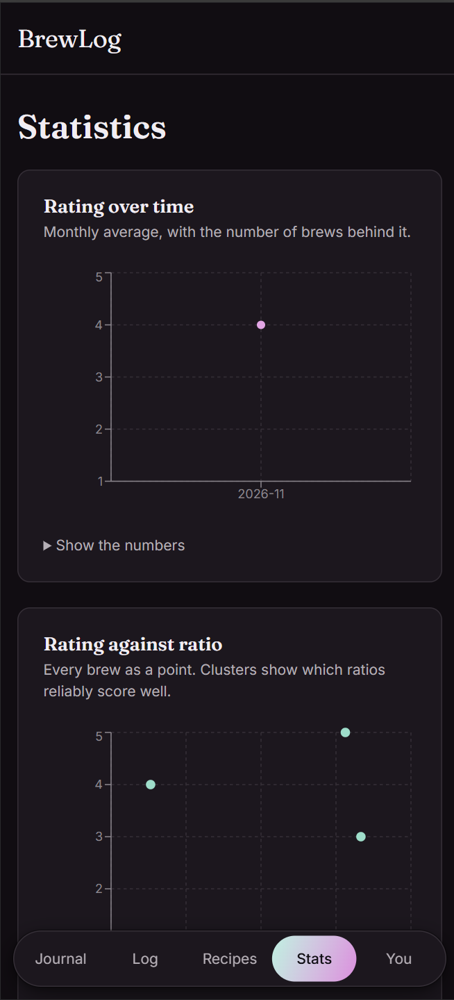
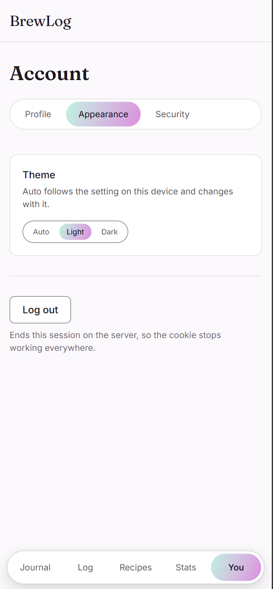

# BrewLog

Live at **https://brewlog-kappa.vercel.app** (the custom domain brewlog.hmstd.dev is planned, not
connected yet), hosted on Vercel with a Postgres database on Neon. Every push to `main` deploys
itself; see [docs/RUNBOOK.md](docs/RUNBOOK.md) for the setup, rollback
and what to check after a deploy.

A personal specialty coffee brewing journal. Record the parameters of a brew — method, bean,
grind, dose, water, temperature, time — rate the result, and look back later to see which
parameters reliably produce a better cup.

Anyone can register; each account keeps its own journal and sees nothing of anyone else's. Not
a social product and not a tracker: a quiet notebook that happens to do arithmetic.

## Screenshots

<table>
  <tr>
    <td align="center"><br /><sub>A brew</sub></td>
    <td align="center"><br /><sub>Log a brew</sub></td>
    <td align="center"><br /><sub>Statistics</sub></td>
    <td align="center"><br /><sub>Account, light theme</sub></td>
  </tr>
</table>

## Requirements

- Node 22 (`.nvmrc` pins the major; Vercel runs the same one)
- npm 11 or newer. Node 22 still ships npm 10, which refuses to read this lockfile in `npm ci`
  mode; `npm install -g npm@11.6.2` if `npm -v` says otherwise

No database to install. Locally the API runs Postgres in-process (PGlite), which is the real
Postgres engine compiled to WebAssembly.

## Getting started

```bash
npm install
cp .env.example .env
```

Only one value in `.env` is required — the rest have defaults for local work:

```bash
# SESSION_SECRET — signs the session cookie
openssl rand -hex 32
```

Paste it into `.env`, then:

```bash
npm run dev          # API on :3000, web on :5173
```

Open http://localhost:5173 and create an account. The Vite dev server proxies `/api` to the API,
so there is no CORS setup to think about. The database is the directory `./data/pglite`; delete
it to start over, or set `DATABASE_URL=memory://` for one that disappears on exit. Migrations
are applied by the API itself on start.

The dev scripts read `.env` through Node's own `--env-file-if-exists`, so nothing needs to be
exported into the shell and there is no dotenv dependency.

To develop against a real server instead, put a `postgres://…` connection string in
`DATABASE_URL`.

## Commands

```bash
npm run dev          # both apps in watch mode
npm run build        # production build of both
npm run typecheck    # tsc --noEmit across the workspaces, the Vercel function and the e2e specs
npm run lint         # eslint + steiger (FSD boundaries) + stylelint + prettier
npm run fix          # apply the autofixable part of the above
npm run test         # vitest run
npm run test:e2e     # cypress run — needs both apps running, see below
npm run verify       # typecheck + lint + test + build; the gate before every commit
npm run smoke        # checks a running instance — see below
```

`verify` compiles, lints and runs tests. It never starts the built application, so it cannot
tell you whether the native modules, the shipped migrations or the real database driver are
right. That is what `smoke` is for, and every check in it stands for a bug that once shipped
past a green `verify`. Against a local build:

```bash
npm run build:api
DATABASE_URL=memory:// SESSION_SECRET="$(openssl rand -hex 32)" node apps/api/dist/index.js &
SMOKE_API_ONLY=1 SMOKE_ALLOW_REGISTER=1 npm run smoke
```

Against the deployed site (no `SMOKE_API_ONLY`, so the static site, the rewrites and the CSP
header are checked too):

```bash
SMOKE_URL=https://brewlog.hmstd.dev SMOKE_EMAIL=… SMOKE_PASSWORD=… npm run smoke
```

Backend-specific:

```bash
npm run db:generate      # generate a migration from a schema change
npm run openapi:export   # regenerate apps/api/openapi.json from the Zod schemas
npm run gen:api          # regenerate the client's types from openapi.json
```

There is no `db:migrate`: the application applies pending migrations itself on start, under an
advisory lock so that several instances starting together cannot collide.

`openapi.json` and the generated client types are committed, and CI fails if either has drifted
from the code. Neither is ever edited by hand.

The end-to-end suite needs the app running and the credentials it should use:

```bash
npm run dev
CYPRESS_BREWLOG_PASSWORD='…' npm run test:e2e
```

The suite signs in **once** for the whole run and reuses the session, because the API allows
five login attempts per quarter hour and a suite that signs in per test spends that budget
immediately — every later case then fails with 429, which looks like a broken application and
is not one.

## Environment

Every variable is listed in [.env.example](.env.example) with an empty value. Nothing real goes
into git. In production they are set in the Vercel project, not in a file.

| Variable                           | Purpose                                                             |
| ---------------------------------- | ------------------------------------------------------------------- |
| `DATABASE_URL`                     | `postgres://…` in production. Locally empty (PGlite) or `memory://` |
| `SESSION_SECRET`                   | Signs the session cookie; 32 characters or more                     |
| `SWAGGER_USER`, `SWAGGER_PASSWORD` | Basic auth for `/docs`; required outside development                |
| `AUTH_RATE_LIMIT_MAX`              | Credential attempts per quarter hour per address; default 5         |
| `VITE_API_URL`                     | API base for the frontend. Public — it ships in the bundle          |

The app refuses to start if a required variable is missing or too weak, and reports the variable
names without their values. In production it also refuses a `DATABASE_URL` that is not a
`postgres://` string: PGlite would boot, answer every health check and lose the journal with
the instance.

## Stack

Vite + React 19 + TypeScript strict, Feature-Sliced Design, CSS Modules over `radix-ui`
primitives, Recharts. Fastify + Zod + Drizzle over Postgres on the server, with `openapi.json`
generated from the same schemas that validate requests. The SPA is static files on Vercel's CDN;
the API is one serverless function. The reasoning, including where this deviates from the house
defaults and why, is in [docs/adr/0001-stack.md](docs/adr/0001-stack.md) and
[docs/adr/0003-vercel-and-postgres.md](docs/adr/0003-vercel-and-postgres.md).

## Documentation

- [SPEC.md](SPEC.md) — scope, screens, data model, API contract, acceptance criteria
- [docs/ARCHITECTURE.md](docs/ARCHITECTURE.md) — how a request flows and where types come from
- [docs/SECURITY.md](docs/SECURITY.md) — the security review, its findings and its accepted gaps
- [docs/RUNBOOK.md](docs/RUNBOOK.md) — first-time setup, health checks, rollback, backups
- [docs/adr/](docs/adr/) — architecture decisions
- [CHANGELOG.md](CHANGELOG.md) — what shipped, and what is knowingly missing

## Status

Moved from a single VPS to Vercel and Neon. On 2026-11-07 the full smoke test passed against the
live deployment at https://brewlog-kappa.vercel.app: registration, sign-in, brews, recipes, a photo
round trip, the CSP header and the rewrites. **Not yet done:** connecting the custom domain
brewlog.hmstd.dev, and rehearsing a restore from Neon.

Still missing: metrics, log aggregation beyond what Vercel keeps, and alerting. **Nobody is
watching this service** — if it falls over, the way you find out is by opening it.
