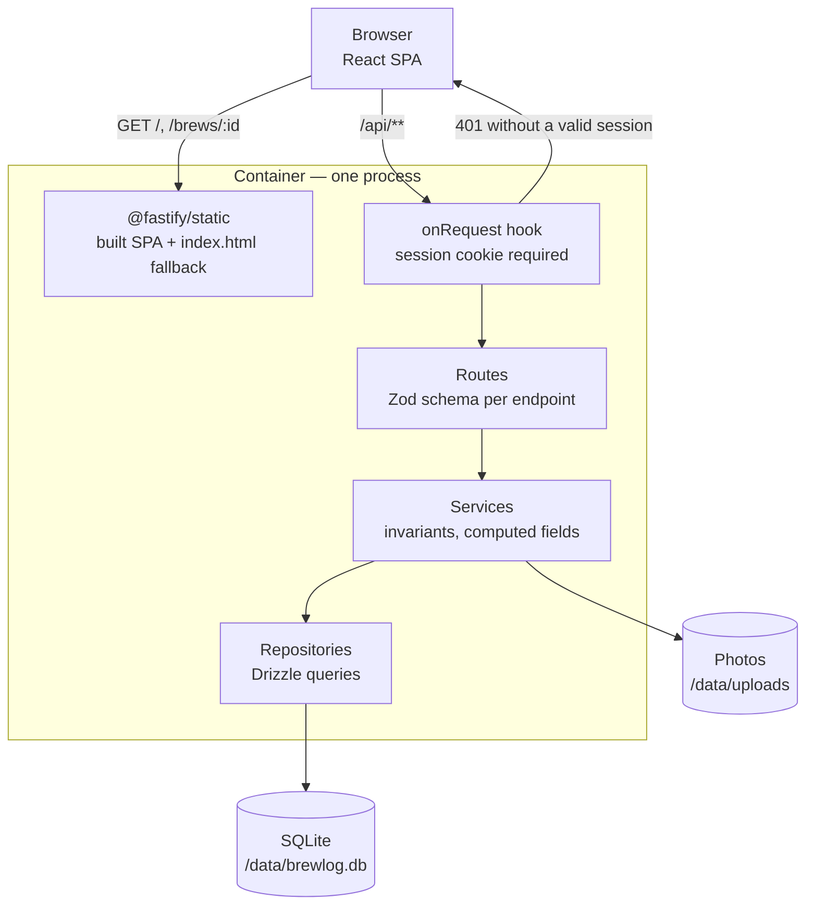
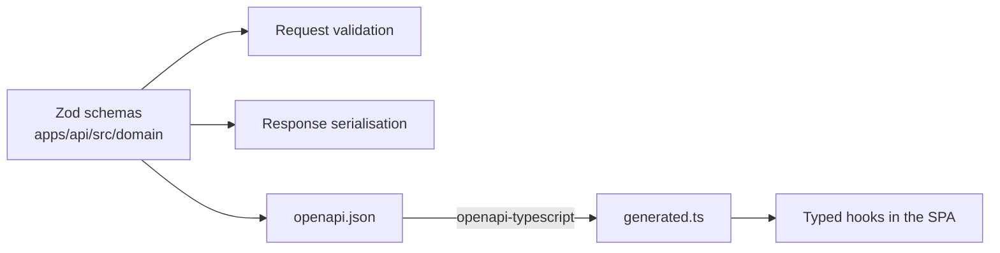

# Architecture

One repository, two applications, one container. The API serves both the JSON endpoints and the
built single-page app, so there is nothing to keep in sync between two deployments.

## Request flow



The gate sits over the whole `/api` scope and is opt-**out**: a route is protected unless it
declares `config: { public: true }`. Only the login, the logout and the two health probes do.

## Layers on the server

| Layer           | Responsibility                                        | Knows about     |
| --------------- | ----------------------------------------------------- | --------------- |
| `routes/`       | HTTP shape: paths, status codes, schemas              | services        |
| `services/`     | Rules: invariants, computed values, error mapping     | repositories    |
| `repositories/` | SQL only                                              | Drizzle, schema |
| `domain/`       | Zod schemas — the source everything else derives from | nothing         |

`openapi.json` is generated from the same Zod schemas that validate requests and serialise
responses. It is never edited by hand, and CI fails if the committed file drifts from the code.

## Layers on the client

Feature-Sliced Design, enforced by `steiger` inside `npm run lint`:

```
app → pages → widgets → features → entities → shared
```

Imports only ever point down that list, and a slice is reached only through its `index.ts`.
Three slices were merged into their pages during review because exactly one page used each —
FSD is a tool for separating things that need separating, not a filing quota.

## State

| Kind of state                 | Where it lives            | Why                                                                                               |
| ----------------------------- | ------------------------- | ------------------------------------------------------------------------------------------------- |
| Server data                   | RTK Query cache           | One place that knows about loading, errors, invalidation and refetching                           |
| Filters, search, sort, paging | The URL                   | Survives a reload, can be bookmarked, and the back button behaves                                 |
| Form values                   | react-hook-form, local    | Nothing outside the form needs them                                                               |
| Session                       | The `authenticated` query | The cookie is httpOnly, so the client cannot read it; asking the server is the only honest answer |

There is no Redux slice. A store with one reducer does not need a module of its own, and
inventing "session state" beside the session query would create two sources of truth.

## Data that is computed, not stored

`ratio` is water divided by dose. `daysAfterRoast` is the gap between the roast date and the brew
date. Both are derived on read. Storing them would let them drift the first time someone corrects
a dose without recomputing.

## The type path



A field renamed in a Zod schema changes the OpenAPI document, which changes the generated types,
which breaks the build at every call site that used the old name. The failure arrives at compile
time rather than as a blank field in production.

## What is deliberately absent

No CORS configuration — the SPA and the API share an origin. No message queue, no cache layer, no
container for the database: SQLite is a file, and a single-user journal has no concurrency to
manage. No user table: there is one password and no accounts.
